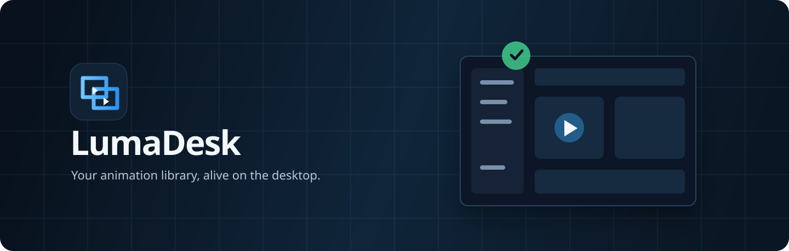

<picture>
  
</picture>

<p align="center">
  Organize your GIFs, APNGs, WebPs, and images, then place them on your desktop as lightweight overlays.
</p>

<p align="center">
  <a href="https://github.com/bayurifkialghifari/lumadesk/actions/workflows/ci.yml"></a>
  <a href="https://github.com/bayurifkialghifari/lumadesk/releases"></a>
  <a href="LICENSE"></a>
</p>

## What you can do

- Import GIF, APNG, WebP, PNG, and JPEG files through the native picker or drag and drop.
- Search, tag, favorite, rename, and remove items from a local library.
- Create multiple transparent overlays with independent position, size, opacity, speed, and direction.
- Drag overlays directly on the desktop, then play, pause, flip, duplicate, or close them from the always-visible toolbar.
- Use familiar Hide, Minimize, Maximize/Restore, and Close controls in the custom title bar.
- Restore your overlay layout when the application starts again.
- Keep everything local, with no account and no telemetry.

## Download

| System | Package |
| --- | --- |
| Windows 10/11 x64 | NSIS `.exe` installer |
| Windows 11 ARM64 | NSIS `.exe` installer |
| macOS Apple Silicon | ARM64 `.dmg` |
| macOS Intel | x86-64 `.dmg` |
| Linux x86-64 | `.AppImage`, `.deb`, and `.rpm` |
| Linux ARM64 | `.AppImage`, `.deb`, and `.rpm` |

Installers are published through [GitHub Releases](https://github.com/bayurifkialghifari/lumadesk/releases). Development builds can also be run from source.

## Development

Install the native prerequisites listed by [Tauri 2](https://v2.tauri.app/start/prerequisites/) for your operating system, then run:

```bash
pnpm install
pnpm tauri dev
```

Run the primary checks with:

```bash
pnpm check
pnpm test
cargo test --workspace
```

## Documentation

- [Animation library](docs/animation-library.md)
- [Importing media](docs/importing-media.md)
- [Desktop overlays](docs/desktop-overlays.md)
- [Window and application lifecycle](docs/window-lifecycle.md)
- [Settings and local data](docs/settings-and-local-data.md)
- [Installation and releases](docs/installation-and-releases.md)
- [Product requirements](PRD.md)
- [Design system](DESIGN.md)
- [Architecture](architecture.md)
- [Changelog](CHANGELOG.md)

## License

LumaDesk is available under the [MIT License](LICENSE). Third-party starter assets always include their own license records.
