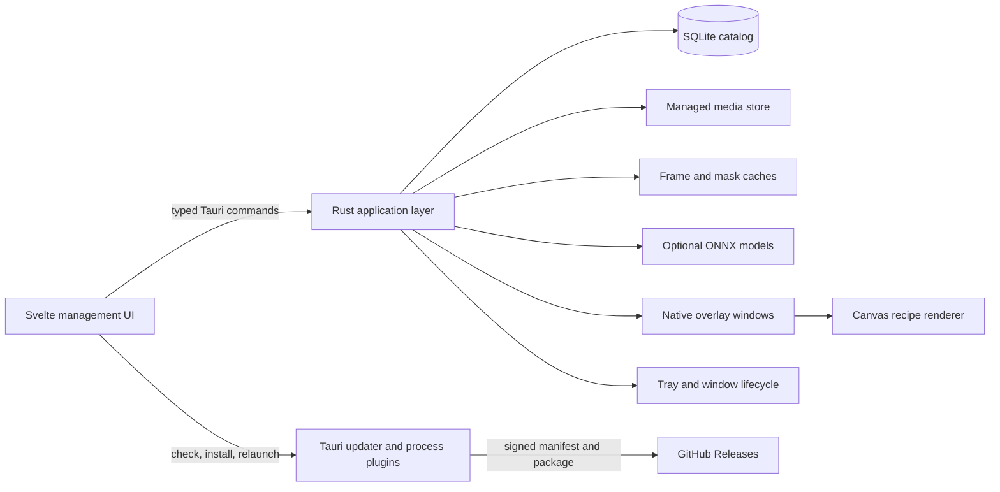

# LumaDesk Architecture

## System shape

LumaDesk is a Tauri 2 desktop application. Svelte 5 renders the management window and overlay control surfaces. Rust owns trusted boundaries: files, SQLite, media decoding, edit validation, model management, generated caches, application lifecycle, and native windows.

## Repository boundaries

- `src/`: Svelte application, runtime schemas, typed command client, controllers, pages, components, and CSS tokens.
- `src-tauri/src/`: Tauri commands, native window coordination, local model inference, single-instance behavior, and tray lifecycle.
- `crates/lumadesk-core/`: platform-independent domain types, SQLite repositories, import pipeline, edit validation, frame decoding, and generated-media records.
- `assets/starter/`: redistributable starter media and license records.
- `docs/`: one English guide per user-facing feature.

The core crate has no Tauri dependency. Database, editing, importing, sprite decoding, and cache behavior run in tests without a graphical session.

## Data model

### `media_items`

Each item stores its UUID, unique SHA-256 content hash, display name, managed path, asset kind, media format, dimensions, frame metadata, favorite state, and timestamps. Tags use `tags` and `media_tags`. The backend resolves managed paths from item IDs; arbitrary frontend paths are never accepted for catalog operations.

### `edit_recipes`

One recipe belongs to each media item. It stores an optional crop, quarter-turn rotation, horizontal flip, background-removal mode, brightness, contrast, saturation, and update timestamp. The recipe describes presentation and never rewrites the source file.

### `sprite_sequences`

An optional row stores columns, rows, frame count, frame duration, and loop, once, or ping-pong playback. Setting a sequence changes the item's asset kind to `sprite_sheet`; clearing it returns the item to its source-derived kind.

### `media_variants`

Generated assets are registered with a media ID, variant kind, validated relative path, dimensions, and creation time. AI masks use the `segmentation_mask` kind. The table lets cache cleanup, media deletion, sprite changes, and model removal delete both files and database records consistently.

### `overlay_instances`

Each instance references a media item and stores logical position, monitor identity, width, opacity, speed, horizontal flip, immediate edge-removal state, click-through state, playback state, z-order, and active state. Logical coordinates avoid DPI-dependent persistence. The media recipe and sprite sequence apply in addition to these per-instance controls.

### `desktop_scenes` and `desktop_scene_items`

A scene owns a unique case-insensitive name and an ordered snapshot of the complete persisted overlay layout. Each item stores media identity, saved monitor name and dimensions, normalized position, size, opacity, speed, flip, background removal, playback, click-through, z-order, and visibility. Deleting media removes dependent scene items while leaving the scene itself available for review or update.

### `settings`

A key/value table stores theme, startup behavior, overlay restoration, close-to-tray behavior, Collection view, and overlay defaults. The application layer parses and validates the complete typed settings object before exposing it.

## Creator save transaction

`save_creator_changes` validates the recipe and the proposed sprite sequence against the same effective frame dimensions. It then writes both records in one SQLite transaction. Invalid sprite metadata or an out-of-bounds crop cannot leave a partially updated recipe.

After a successful sprite change, the application removes decoded frames and segmentation variants whose dimensions or source key are now stale, then emits an update to active overlay windows. Generated-media operations share an async lock so Creator saves, model removal, mask generation, media deletion, and cache cleanup do not race over the same files.

## Command surface

The frontend calls serializable commands whose responses are checked again with Zod schemas. Major groups include:

- catalog: list, import, rename, favorite, tag, remove, resolve asset URL, and get frame batches;
- Creator: get or update recipes, atomically save Creator changes, and get, set, or clear sprite sequences;
- overlays: list, create, show, move, move between monitors, update, duplicate, remove, patch all, and close all;
- scenes: list, create, update, rename, duplicate, delete, and apply complete desktop snapshots;
- settings: get, update, open the data directory, and clear generated caches;
- local AI: list model status, download, remove, and request a bounded mask batch.

Inputs are validated at the command boundary. Domain failures map to stable error codes with English messages. If a native overlay update fails, persisted instance state is rolled back. Overlay and media removal close dependent windows before deleting records and restore captured windows when persistence fails.

Monitor descriptors come from Tauri in logical coordinates. Moving one overlay preserves its normalized position from the source display, maps it to the selected display, and clamps its rendered bounds. Scene application resolves a saved monitor by name and falls back to the primary display, or the first available display when no primary is reported.

Applying a scene first prepares all media and target coordinates, replaces the persisted overlay layout transactionally, and then synchronizes native windows. A native failure restores both the previous database layout and its windows. Global show, hide, play, pause, lock, and unlock operations use the same persistence-first synchronization with rollback.

## File ownership

Application data contains `lumadesk.sqlite3`, `media/`, `thumbnails/`, `frames/`, `masks/`, and `models/`. Import writes to a temporary file, hashes and decodes it, moves it atomically into `media/`, then commits the catalog row. A scope guard removes temporary data if any stage fails.

Model downloads use a `.part` file and become available only after exact length and SHA-256 verification. Fast and Quality model files remain optional and removable. Clearing generated cache removes previews, decoded frames, and masks while preserving the database, managed source media, settings, and installed models.

The frontend receives asset URLs only for approved media and cache roots. Deletion quarantines a managed file before the database transaction, restores it on failure, and clears stale quarantine files at startup.

## Rendering and playback

Rust generates a persistent frame cache atomically. The frontend requests bounded frame batches, prefetches near a batch boundary, and keeps only the current and next batch in memory. Static images render once without a scheduler. Sprite sheets are decoded cell by cell according to their saved sequence and expose normalized playback frames for the same player.

The preview and overlay renderers apply crop, rotation, recipe flip, color filters, and the selected background mode. Loop, once, and ping-pong sequences share the same timing controller. The per-instance flip combines with the recipe flip without changing stored media.

Edge removal flood-fills similar pixels connected to frame boundaries and feathers their alpha. AI modes request masks generated by U²-NetP or U²-Net through `tract-onnx`. Masks are keyed by media content and sprite metadata, stored as regenerable PNG variants, and composited through a bounded canvas cache.

## Native windows and lifecycle

Each visible overlay is an undecorated, transparent, always-on-top Tauri window whose label derives from an internal instance UUID. Pressing the animation reveals its compact toolbar and boundary. Native dragging starts from the animation or drag handle, and a debounced serial writer persists logical position. Click-through disables focus and ignores cursor events at the native-window layer.

The management window uses a custom title bar with Minimize, Maximize/Restore, and Close. At startup, the updater plugin reads the signed release manifest from GitHub. A newer version replaces the quiet version label with an install action. The frontend reports download progress, while the native plugin downloads, verifies, and installs the platform package before the process plugin relaunches LumaDesk. Failed checks remain quiet for offline use; failed installations return to the available state and surface a toast. If relaunching fails after installation, the controller preserves a restart-required state so the process can be relaunched without downloading the package again.

Closing hides the management window to the tray or menu bar when `close_to_tray` is enabled. Tray actions restore the window, show or hide all overlays, play or pause all overlays, lock or unlock click-through, or quit the process. Single-instance launches use the same restore path. Overlay windows bypass the main-window close handler.

## Migrations and compatibility

- SQL migrations are embedded in the core crate and run in one transaction at startup.
- Schema versions increase monotonically; downgrade is unsupported.
- A newer unknown schema fails closed with a backup instruction.
- Settings introduced in later versions receive explicit defaults.

## Release architecture

Pushes and pull requests run frontend types, tests, lint, build, Rust formatting, workspace tests, and Clippy. Tags matching `vMAJOR.MINOR.PATCH` build Windows x86-64 and ARM64 NSIS installers, macOS Apple Silicon and Intel DMGs, and Linux x86-64 and ARM64 AppImage, Debian, and RPM packages. Each matrix job also creates an updater archive and detached signature using the protected updater key.

Publishing starts only after every platform job succeeds. The publisher preserves each matrix directory while resolving updater targets, flattens uniquely named release assets, generates `latest.json` with six platform entries and GitHub download URLs, then creates `SHA256SUMS.txt`. The public key embedded in the app verifies updater packages; the private key exists only in GitHub Actions secrets. Operating-system code signing and macOS notarization remain separate release credentials.
