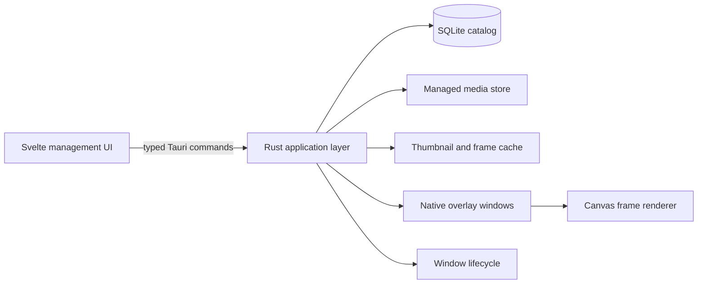

# LumaDesk Architecture

## System shape

LumaDesk is a Tauri 2 desktop application. Svelte 5 renders the management window and small overlay control surfaces. Rust owns trusted boundaries: files, SQLite, media decoding, cache management, application lifecycle, and native windows.

## Repository boundaries

- `src/`: Svelte application, typed command client, stores, pages, components, and CSS tokens.
- `src-tauri/src/`: Tauri adapter, commands, single-instance and tray lifecycle handling, and native window coordination.
- `crates/lumadesk-core/`: platform-independent domain, SQLite repositories, import pipeline, hashing, and media metadata.
- `assets/starter/`: redistributable starter animation sources and license records.
- `docs/`: user-facing feature and contribution guides.

The core crate has no Tauri dependency. Its database and import behavior can run in tests without a graphical session.

## Data model

### `media_items`

| Field | Meaning |
| --- | --- |
| `id` | UUID primary key |
| `content_hash` | unique SHA-256 of imported bytes |
| `display_name` | user-editable catalog name |
| `managed_path` | relative path inside the media root |
| `media_kind` | gif, apng, webp, png, or jpeg |
| `width`, `height` | decoded pixel dimensions |
| `frame_count` | number of decoded frames |
| `duration_ms` | total loop duration |
| `is_favorite` | favorite filter state |
| `created_at`, `updated_at` | UTC timestamps |

Tags use `tags` and `media_tags` tables. `managed_path` is never accepted from the frontend; the backend resolves it from the item ID.

### `overlay_instances`

Each record references a media item and stores logical x/y position, monitor identity, width, opacity, speed, horizontal flip, background-removal state, playback state, z-order, and active state. Logical coordinates avoid DPI-dependent persistence.

### `settings`

A key/value table stores typed application preferences. The application layer parses every value into a typed settings structure before exposing it.

## Command surface

The frontend calls serializable commands with typed inputs and outputs:

- `list_media(query) -> MediaPage`
- `import_media(paths) -> ImportReport`
- `rename_media(input) -> MediaItem`
- `set_favorite(input) -> MediaItem`
- `replace_tags(input) -> MediaItem`
- `delete_media(input) -> DeleteReport`
- `resolve_media_path(id) -> string`
- `get_frame_batch(id, offset, limit) -> FrameBatch`
- `list_overlays() -> OverlayInstance[]`
- `list_desktop_overlays() -> DesktopOverlay[]`
- `create_overlay(input) -> OverlayInstance`
- `show_media_overlay(id) -> OverlayInstance`
- `update_overlay(input) -> OverlayInstance`
- `move_overlay(id, monitor_id, x, y) -> OverlayInstance`
- `duplicate_overlay(id) -> OverlayInstance`
- `remove_overlay(id) -> void`
- `get_settings() -> AppSettings`
- `update_settings(settings) -> AppSettings`

The native layer emits `overlay:state` to the matching overlay window after persisted state changes and `overlay:catalog-changed` when the management view must refresh. A failed native update restores the previous persisted state, while overlay and media removal close dependent windows before deleting their records. If persistence fails, closed windows are restored from the captured state. Inputs are validated once at the command boundary. Domain failures map to stable error codes plus English user messages.

## File ownership

Application data contains `lumadesk.sqlite3`, `media/`, `thumbnails/`, and `frames/`. Import writes to a temporary file, hashes and decodes it, moves it atomically into `media/`, then commits the database row. A scope guard removes temporary data if any stage fails.

The frontend receives asset URLs only for managed media and cache roots. It cannot request arbitrary local paths. Deletion removes the catalog record and dependent overlay records transactionally, then removes managed media and regenerable cache data. A managed file is quarantined before the transaction, restored if that transaction fails, and stale quarantine files are cleared at startup.

## Rendering and windows

Rust reads animation metadata and generates a persistent frame cache atomically. The frontend requests batches of 32 frames, prefetches near the active batch boundary, and retains at most the current and next batch in memory. The transparent canvas renderer uses original frame timing adjusted by the persisted speed multiplier. Static images render once without starting a playback scheduler.

Automatic background removal runs as a non-destructive canvas effect owned by each overlay renderer. It estimates the dominant edge color, flood-fills only similar pixels connected to frame boundaries, feathers their alpha, and preserves existing transparent pixels. Processed canvases are created lazily per frame and leave memory when their bounded playback batch is evicted. The managed source and persistent decoded frame cache remain unchanged.

Each active overlay is an undecorated, transparent, always-on-top Tauri window. Its label is derived from an internal instance UUID. Overlay windows always accept pointer input, display a compact toolbar and boundary, start native window dragging from either the animation surface or drag handle, and persist the latest logical position through a debounced serial writer. The management window lists active instances and exposes size, opacity, speed, playback, flip, background removal, duplicate, close, pause-all, and close-all controls. Active instances are restored at startup when `restore_overlays` is enabled, and deleting media also destroys its native windows. macOS builds enable the required private transparent-window API and are distributed directly rather than through the App Store.

The main window uses a custom title bar. Tauri window APIs provide Minimize, Maximize/Restore, and Close actions, while the remaining title-bar area acts as a native drag region. A dedicated lifecycle module intercepts close requests only for the main window, reads the persisted `close_to_tray` preference, and hides the window by default. The tray or menu-bar icon restores the main window or exits the process; single-instance launches use the same restore path. Overlay windows bypass this handler.

## Migrations and compatibility

- SQL migrations are embedded in the core crate and run in one transaction at startup.
- Schema version is monotonic; downgrade is unsupported.
- Unknown newer schema versions fail closed with a backup instruction.
- Settings added in later versions receive explicit defaults.

## Release architecture

Pull requests and main-branch pushes run formatting, linting, type checks, and tests. The release workflow can package Windows x86-64 and ARM64, macOS Apple Silicon and Intel, and Linux x86-64 and ARM64 without publishing when started manually. Tags matching `vMAJOR.MINOR.PATCH` package the same targets, calculate SHA-256 checksums, and publish a GitHub Release. Publishing requires every platform job to succeed. Signing and notarization use protected repository secrets when configured.
